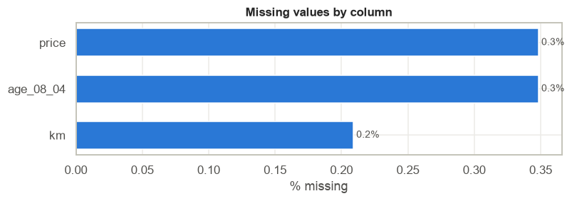
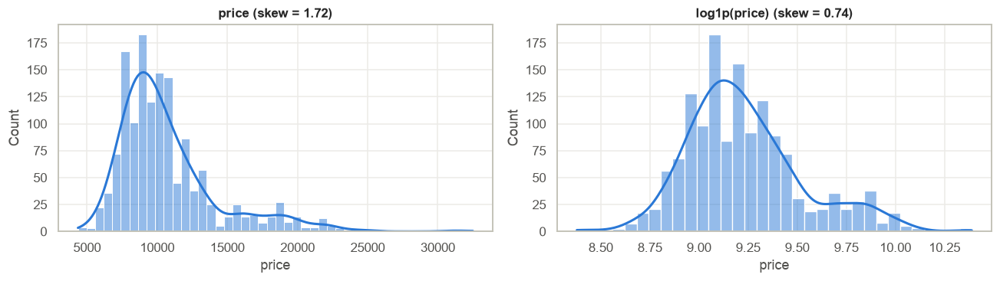
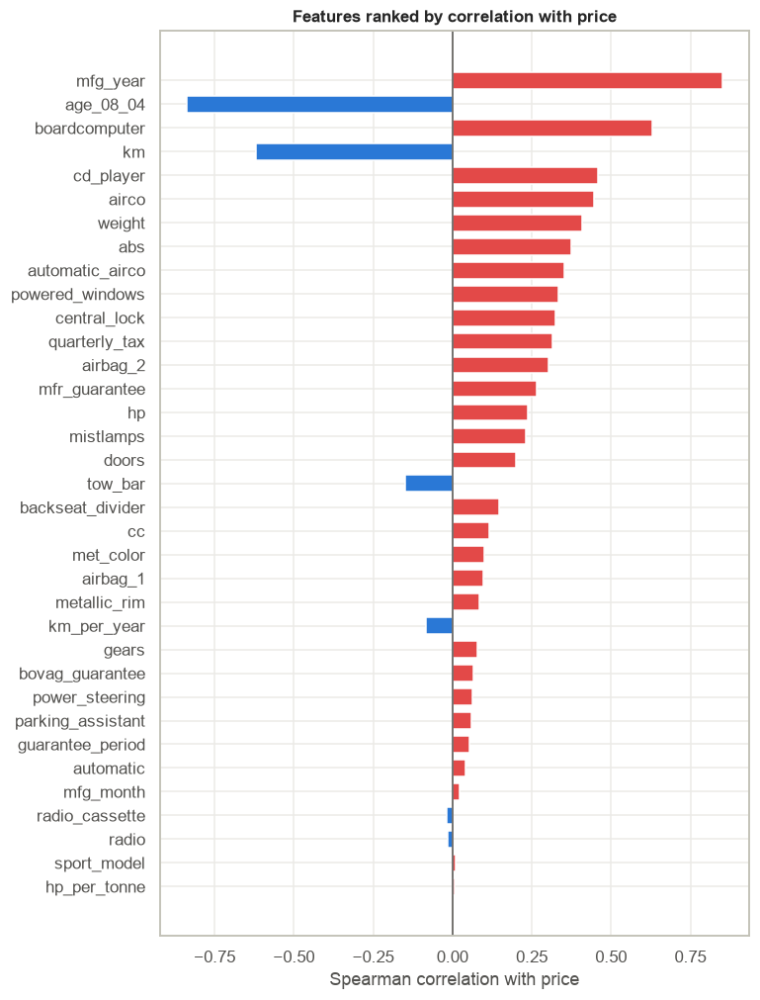
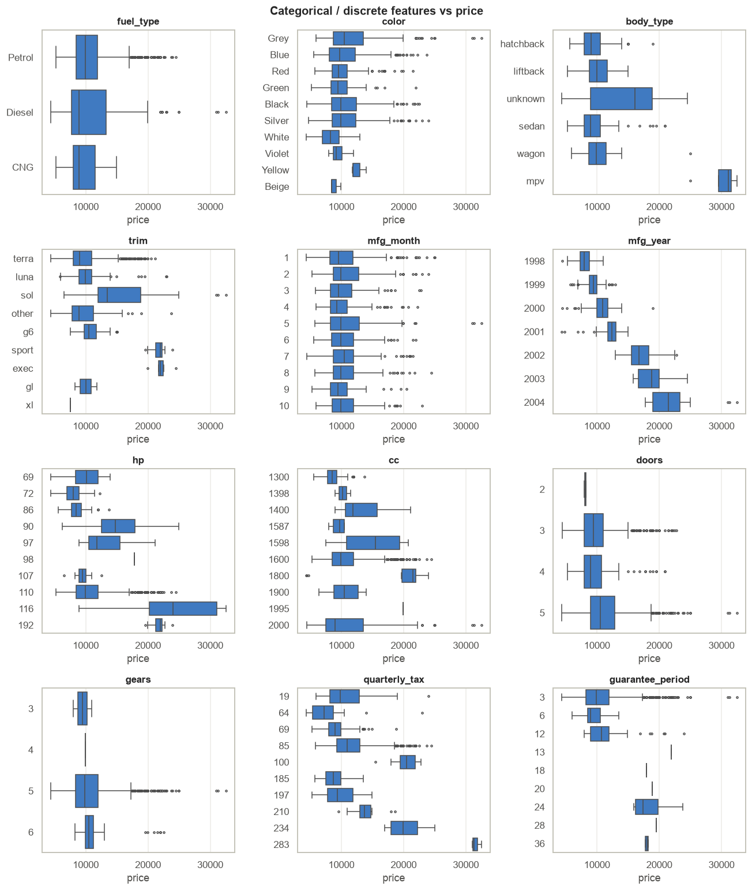
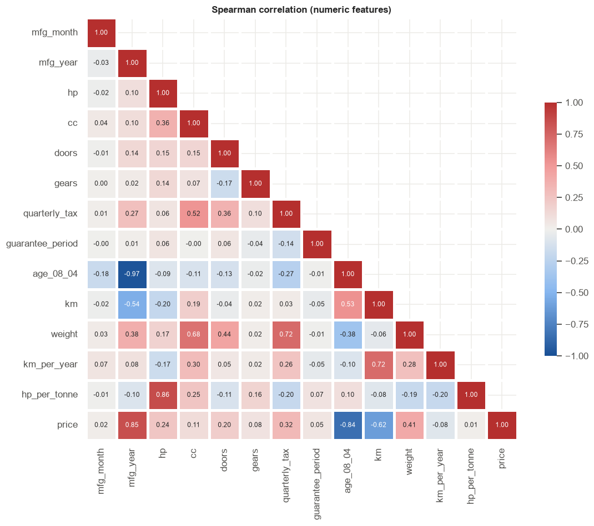
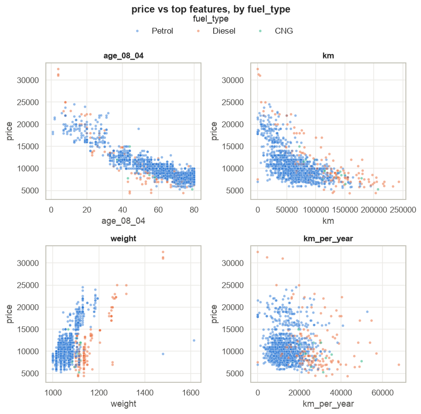

# EDA Findings: Toyota Corolla Used-Car Prices (Demo)

Produced by running [`notebooks/eda_template.ipynb`](../notebooks/eda_template.ipynb) on
`data/raw/toyota_corolla.csv`. Section numbers (§) point to the notebook section where each finding comes from.
Figures are written to `reports/figures/` when the notebook runs.

## TL;DR

1. **Age is the price.** Manufacturing year / age alone has a Spearman correlation of **0.85** with price. Median price climbs from €7,950 (1998) to €21,725 (2004).
2. **Data is clean apart from a few targeted errors**: 13 nulls (0.9% of rows), 1 duplicate car, 1 typo in `cc`, and a handful of suspicious `km = 1` and `weight` values.
3. **Rows are sorted by price/age.** `id` predicts price (r = −0.79). Shuffle before any train/test split.
4. **Equipment flags look strong but are mostly age in disguise.** Cars with `automatic_airco` or `boardcomputer` are ~2–3 years newer than cars without.
5. **Price is right-skewed (skew 1.72).** A log target brings it to 0.74. Use RMSLE or train on `log1p(price)`.

## 1. Dataset at a glance (§2)

| Item | Value |
|---|---|
| Rows × columns | 1,436 × 39 |
| Target | `price` (EUR), regression |
| Column types (§6.0) | 5 continuous, 8 discrete, 22 binary, 5 categorical, 1 constant |
| Period | Cars made 1998–2004; age measured in months as of Aug 2004 |

## 2. Data quality (§3, §4)

| Issue | Detail | Action |
|---|---|---|
| Missing values | `price` 5, `age_08_04` 5, `km` 3 (13 rows, 0.9%). Nulls never co-occur on the same row → likely MCAR. | Drop the 5 null-target rows; median-impute `age_08_04` and `km` (fit on train only). |
| Duplicate record | Ids 114 and 115 are identical except for the id (Corolla Verso, €24,950). | Dropped (§3.4). |
| Typo | One car has `cc = 16000`; the model name says 1.6 litres. | Fixed to 1600 (§3.5). |
| Constant column | `cylinders` = 4 for every car. | Dropped (§6.0). |
| Suspicious mileage | 9 cars have `km ≤ 15`; 7 are near-new (≤ 9 months), but two are 50 and 76 months old. | Treat the two old cars' `km` as missing. |
| Suspicious weight | One 1.6 hatchback weighs 1,615 kg (fleet median 1,070 kg); one row has model = `"Corolla"` only and weighs 1,480 kg. | Confirm with data owner; set to missing if unconfirmed. |
| Near-constant flags | `parking_assistant` (99.7% zeros), `power_steering` (97.8% ones), `airbag_1` (97.1% ones). | Little signal; drop or leave for tree models. |

## 3. Target: `price` (§6.1.1)

* Median **€9,900**, middle 50% between €8,450 and €11,930, max €32,500.
* Right-skewed (skew **1.72**), with a secondary bump around €18–20k from newer (2002–2004) cars.
* 110 cars (7.7%) sit above the IQR fence (€17,147). They are **real** newer/higher-trim cars, not errors. Keep them.
* `log1p(price)` cuts skew to **0.74**.

## 4. Key drivers (§6.2)

Ranked by absolute Spearman correlation with price:

| Rank | Feature | ρ | Reading |
|---|---|---|---|
| 1 | `mfg_year` / `age_08_04` | +0.85 / −0.84 | Strongest driver by far. Roughly linear: about −€170 per month of age. |
| 2 | `boardcomputer` | +0.63 | Median +€4,000, but these cars are newer (median 2001 vs 1999). |
| 3 | `km` | −0.62 | Steep drop over the first 50k km, flatter after. Non-linear. |
| 4 | `cd_player`, `airco` | +0.46, +0.44 | Comfort-equipment premium. |
| 5 | `weight` | +0.41 | Mostly a proxy for diesel / larger body types. |

Categorical drivers (§6.2, box plots):

* **Trim** (extracted from `model` in §3.2) has a clear price ladder: Terra €9.0k → Luna €9.9k → Sol €13.5k → Sport / Exec ~€22k.
* **Body type**: the 5 MPVs (Verso) sell for about €30k. Hatchback, liftback, sedan and wagon overlap heavily (€9–11k medians).
* **Fuel type**: medians are similar (Petrol €9.9k, Diesel and CNG €9.0k), but diesel has the widest spread (std €5.4k) and the most expensive cars.
* **Colour**: no meaningful effect. Violet, Yellow and Beige have fewer than 1% of rows each → fold into "other".

## 5. Redundancy and leakage (§6.3)

| Pair | ρ | Decision |
|---|---|---|
| `mfg_year` ↔ `age_08_04` | −0.97 | Same information. Keep `age_08_04` (finer, in months). |
| `hp` ↔ `hp_per_tonne` | +0.86 | The engineered ratio adds nothing (ρ with price = 0.01). Drop it. |
| `cc` ↔ engine size in `model` | 1.00 | Did not extract engine size from `model`. |
| `id` ↔ `price` | −0.79 | **Leakage risk**: the file is sorted. Never use `id` as a feature; shuffle before splitting. |

Engineered `km_per_year` is also weak (ρ = −0.08). Raw `km` and age carry the signal separately.

## 6. Segments (§6.3.1)

* **Older diesels sell for less** than petrol cars of the same age: median €8,950 vs €10,950 at 40–60 months, €7,950 vs €8,750 at 60–80 months. Under 20 months diesels cost more (€22,250 vs €18,775), driven by the Verso MPVs. Fuel type × age is an interaction worth modelling.
* Diesel and CNG cars pay about 2× the quarterly road tax of petrol cars (median €185–197 vs €85). This explains why `quarterly_tax` shows up as a driver.
* Diesels drive further: 36 of the 52 cars above 150,000 km are diesel, despite diesels being 11% of the fleet.

## 7. Actions before modelling

| # | Action | Column(s) | Why |
|---|---|---|---|
| 1 | Shuffle, then split train/test (stratify on price bins) | all | Rows are ordered by price/age |
| 2 | Drop rows with null target | `price` | 5 rows, cannot train on them |
| 3 | Median-impute; set implausible `km` to missing first | `age_08_04`, `km` | MCAR, < 0.5% each |
| 4 | Drop redundant / empty features | `id`, `mfg_year`, `cylinders`, `hp_per_tonne`, `model` (after extraction) | Leakage, redundancy, no variance |
| 5 | One-hot encode, fold rare levels into "other" | `fuel_type`, `body_type`, `trim`, `color` | Rare levels < 1% |
| 6 | Train on `log1p(price)`, report RMSE in EUR | `price` | Skew 1.72 → 0.74 |
| 7 | Prefer models that handle non-linearity (trees / GBMs), or add `km` splines | `km`, `age_08_04` | Curved `km` relationship |

## 8. Open questions for the data owner

1. Are the two old cars with `km = 1` odometer errors or unknown mileage?
2. Is the 1,615 kg hatchback (id 223) a data-entry error?
3. Are prices final sale prices or asking prices?
